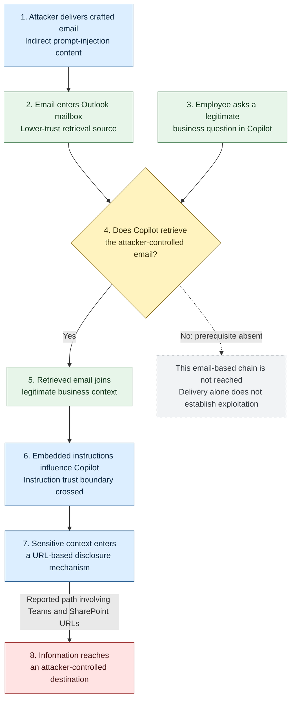

## Executive summary

EchoLeak demonstrated that an attacker did not need to compromise an employee's
account or persuade them to click a malicious link. Attacker-controlled email
content could influence Microsoft 365 Copilot when it processed business
information, causing sensitive information from the assistant's context to be
disclosed.

Aim Labs, part of Aim Security, named the vulnerability EchoLeak. Microsoft
tracks it as **CVE-2025-32711**, an information-disclosure vulnerability in
Microsoft 365 Copilot, and rates it **Critical**, with a **CVSS v3.1 base score
of 9.3**. [Microsoft's advisory][1] and the [CVE record][2] confirm its identity,
product scope, and severity.

The attack used *indirect prompt injection*: malicious instructions reached the
assistant through external content rather than a prompt submitted directly by
the attacker.

[Contemporaneous reporting][3] describes a crafted email delivered to an
employee's Outlook mailbox. When the employee subsequently used Copilot for an
ordinary business task, the assistant could retrieve the message alongside
legitimate organizational information. Embedded instructions could influence
how Copilot handled sensitive information in its context, leading to disclosure
through a URL-based mechanism involving Microsoft Teams and SharePoint URLs.

The attacker targeted the assistant's interpretation of content, not the
employee's interpretation of a phishing lure.

> [!IMPORTANT]
> Microsoft states that the vulnerability was fully mitigated and that customers
> do not need to take action to resolve this CVE. The historical vulnerability
> must not be presented as an outstanding customer patch requirement.

The lasting lesson is broader than the specific bug: an employee can make a
legitimate request, an assistant can read information using legitimate
permissions, and an attacker can still manipulate how that information is used.

## Vulnerability at a glance

| Attribute                       | Finding                                                                                           |
|---------------------------------|---------------------------------------------------------------------------------------------------|
| Name                            | EchoLeak                                                                                          |
| CVE                             | CVE-2025-32711                                                                                     |
| Official title                  | M365 Copilot Information Disclosure Vulnerability                                                  |
| Affected product                | Microsoft 365 Copilot                                                                              |
| CVE status                      | Published                                                                                         |
| Vendor severity                 | Critical                                                                                          |
| Microsoft CVSS v3.1 base score   | 9.3                                                                                               |
| Microsoft temporal score        | 8.1                                                                                               |
| Current vendor weakness mapping | CWE-74: Injection                                                                                 |
| Primary security impact         | Information disclosure                                                                            |
| Attack vector                   | Network                                                                                           |
| Privileges required             | None, according to Microsoft's CVSS assessment                                                     |
| User interaction                | None in the CVSS assessment; ordinary Copilot use remains part of the reported scenario             |
| Public advisory release         | June 11, 2025                                                                                     |
| Remediation                     | Microsoft-managed service mitigation; no customer action required                                  |
| Research attribution            | Aim Labs; Microsoft also acknowledges a Microsoft researcher                                       |
| Customer-managed version range  | Not specified; the CVE affected-version field contains `"-"`                                        |

Microsoft's description is:

> "AI command injection in M365 Copilot allows an unauthorized attacker to
> disclose information over a network." [1][2]

"AI command injection" is not proof of operating-system command execution. The
documented vulnerability concerns instructions influencing an AI application
and causing information disclosure.

## Why EchoLeak matters

Traditional email defenses often focus on executable attachments, credential
harvesting, impersonation, or links that require a human click.

EchoLeak changes the central question:

**What happens when an AI assistant reads the message on the employee's behalf?**

A message can contain no executable attachment and still carry instructions
capable of manipulating an assistant. Ordinary content becomes dangerous when
the application allows it to influence decisions beyond its legitimate role.

This matters particularly for assistants combining:

1. Access to enterprise information
2. Retrieval of externally influenced content
3. Natural-language reasoning
4. Output or tool mechanisms capable of moving information elsewhere

Assessment: EchoLeak is best understood as a failure to preserve trust
boundaries across an AI workflow, rather than only a failure to recognize
suspicious wording.

## Technical background: retrieval-augmented generation

Microsoft's documentation describes Copilot grounding responses using
organizational sources such as documents, messages, and meetings. [5]

In a typical retrieval-augmented generation (RAG) workflow:

1. A user asks a question.
2. The application retrieves potentially relevant information.
3. Retrieved material is supplied to the model as context.
4. The model generates a response using that context.

Retrieval improves usefulness, but **information can be relevant without being
trustworthy**.

An externally authored email may be relevant to a business question. Its
presence in an employee's mailbox does not make its embedded instructions
equivalent to the employee's request or the application's security policy.

A secure assistant must distinguish the user's authorized task, application
instructions, retrieved facts, and instructions embedded in retrieved content.
EchoLeak's reported attack path exploited a breakdown in that separation.

## The reported attack chain

The following is a conceptual reconstruction based on contemporary reporting,
not an executable reproduction guide. [3]



Solid arrows represent the reported historical sequence. The dotted branch is
an analytical prerequisite check, not an observed defensive outcome.
No interaction with the malicious email is required, but ordinary Copilot use
and retrieval of the email are prerequisites. Microsoft has mitigated this CVE.

### Diagram evidence and mapping

Framework IDs are omitted; all nodes are unmapped because this diagram explains
the reported workflow rather than claiming verified ATT&CK or ATLAS coverage.
Confidence below describes source support, not exploit reliability.

| Node | Phase         | Behavior                               | Framework | Mapping | Confidence | Evidence | Notes                                  |
|------|---------------|----------------------------------------|-----------|---------|------------|----------|----------------------------------------|
| A    | Delivery      | Attacker sends crafted email           | Unmapped  | None    | High       | [3]      | Reported, not reproduced here          |
| B    | Availability  | Mailbox holds attacker content         | Unmapped  | None    | High       | [3]      | Delivery does not prove retrieval      |
| C    | User activity | Employee asks a business question      | Unmapped  | None    | High       | [3]      | Legitimate activity, not attacker action |
| D    | Prerequisite  | Copilot must retrieve the email        | Unmapped  | None    | Medium     | [3]      | Gate derived from the reported path    |
| E    | Grounding     | Context combines email and business data | Unmapped | None   | High       | [3]      | Data exposure depends on context       |
| F    | Injection     | Embedded instructions influence Copilot | Unmapped | None   | High       | [3]      | Reported scope violation               |
| G    | Disclosure    | Sensitive data enters URL-based path   | Unmapped  | None    | High       | [3]      | Exact endpoint details unverified      |
| H    | Impact        | Information reaches attacker           | Unmapped  | None    | High       | [1][3]   | Vendor confirms disclosure class       |
| S    | Absent gate   | This chain is not reached without retrieval | Unmapped | None | Medium     | [3]      | Analytical branch, not tested outcome  |

### Stage 1: deliver attacker-controlled content

The attacker sends an apparently ordinary email to an employee.

The attacker does not need direct access to the employee-only Copilot interface.
Email supplies an indirect route into content the assistant may subsequently
process.

Restricting access to an AI application therefore does not remove the threat
posed by attacker-controlled data entering its retrieval sources.

### Stage 2: reach the assistant through legitimate retrieval

The employee asks Copilot a business-related question.

If the assistant retrieves the malicious email as relevant context, the
attacker's text enters the model's working context alongside legitimate
information.

Delivery is not the same as exploitation. The malicious content must reach the
vulnerable processing path.

### Stage 3: cross the instruction boundary

The injected content attempts to redirect the assistant away from the
employee's intended task.

Aim described the underlying problem as an *LLM Scope Violation*: instructions
from untrusted content influence the handling of more privileged information.
[3]

This is the decisive trust-boundary failure. Source content that should be
treated as data becomes a driver of behavior.

### Stage 4: access sensitive context

Contemporary reporting describes disclosure of sensitive information from the
assistant's current context, with the attack working in both single-turn and
multi-turn conversations. [3]

This does not establish unrestricted access to every document in a tenant.
Exposure depends on what the assistant can access and what enters its context.

### Stage 5: disclose information through a URL-based path

The reporting describes exfiltration involving Microsoft Teams and SharePoint
URLs. [3]

The exact endpoint construction and bypass details were not independently
verified here.

The broader lesson is that an apparently trusted URL or service can participate
in an unsafe data flow. Destination branding alone does not establish that the
information being transmitted is appropriate.

## What zero-click actually means

In the reported scenario, the employee did not need to:

* Open the attacker's email
* Click a malicious link in that email
* Download an attachment
* Enter credentials
* Deliberately approve disclosure

However, the attack narrative includes an employee using Copilot for a normal
business task.

> [!NOTE]
> EchoLeak required no interaction with the malicious email, but relied on
> Copilot processing attacker-controlled content during legitimate assistant use.

It should not be described as a demonstrated attack that instantly stole an
entire mailbox solely because an email arrived.

A zero-click AI attack can be triggered by ordinary assistant behavior rather
than attacker-directed user behavior. The user's legitimate request becomes the
occasion for the attack, not its malicious instruction.

## Root cause: confusing access with authority

Three distinct security decisions matter:

| Security question                                       | Meaning                    |
|---------------------------------------------------------|----------------------------|
| Can the assistant read this content?                     | Access authorization       |
| Should this content influence the assistant's instructions? | Instruction authority   |
| Can information derived from it be sent elsewhere?       | Disclosure authorization   |

An assistant may legitimately read an email without being permitted to obey
instructions inside it. It may legitimately read an internal document without
being permitted to transmit its contents to an external destination.

Assessment: EchoLeak resembles a *confused-deputy problem*. The assistant has
capabilities on behalf of an authorized user, while an attacker influences the
assistant through a lower-trust input channel.

The current vendor weakness mapping is **CWE-74**, a general injection category.
Microsoft updated the CWE value on February 20, 2026, describing that revision
as informational only. [1][2]

### Claims not established by the evidence

The reviewed sources do not establish:

* Remote code execution on an employee's endpoint
* Theft of a Microsoft authentication token
* Modification of the underlying model's weights
* A cross-tenant authorization bypass
* Universal access to an organization's data
* Compromise of every product carrying the Copilot name

These claims require separate evidence and should not be included as facts about
this CVE.

## Impact and severity

### Documented and reported impact

Microsoft confirms information disclosure as the vulnerability's impact. [1][2]
Contemporary reporting describes Aim's demonstration of sensitive-data
exfiltration from Copilot's context. [3]

### Plausible business consequences

Depending on the exposed information, potential consequences include:

* Disclosure of financial or commercial information
* Loss of confidential project details
* Exposure of legal, personnel, or customer information
* Follow-on social engineering using internal context
* Extortion based on stolen information

These are potential consequences, not evidence that a particular organization
experienced them through EchoLeak.

### CVSS interpretation and provenance

Microsoft's base vector is:

```text
CVSS:3.1/AV:N/AC:L/PR:N/UI:N/S:C/C:H/I:L/A:N
```

The CNA record includes temporal metrics:

```text
/E:U/RL:O/RC:C
```

Microsoft's advisory distinguishes the **9.3 base score** from the **8.1 temporal
score**. [1][2]

| Metric | Interpretation                                          |
|--------|---------------------------------------------------------|
| AV:N   | Network-accessible attack vector                        |
| AC:L   | Low complexity in the scoring assessment                 |
| PR:N   | No attacker privileges required                         |
| UI:N   | No required user interaction in the scoring assessment   |
| S:C    | Changed scope                                           |
| C:H    | High confidentiality impact                             |
| I:L    | Low integrity impact                                    |
| A:N    | No availability impact                                  |
| E:U    | Unproven exploit code maturity in the temporal assessment |
| RL:O   | Official fix                                            |
| RC:C   | Confirmed report confidence                             |

The integrity metric does not independently prove file modification or system
takeover. Similarly, the temporal exploit-maturity value should not erase the
separate evidence of a reported research demonstration.

Tenable's CVE page displays a different CVSS v3.1 score, **7.5**, with this vector:

```text
CVSS:3.1/AV:N/AC:L/PR:N/UI:N/S:U/C:H/I:N/A:N
```

That score should not be presented as Microsoft's score or automatically
attributed to NVD without verifying its scoring authority. Microsoft's
assessment is the primary severity reference here. [7]

## Exploitation status and chronology

### Exploitation assessment

| Question                                         | Evidence-supported answer                                                          |
|--------------------------------------------------|------------------------------------------------------------------------------------|
| Was a research attack demonstrated?              | Yes, according to contemporary reporting of Aim's findings                          |
| Was it independently reproduced here?            | No                                                                                 |
| Did Microsoft report exploitation at publication? | No                                                                                 |
| Did the contemporary report identify wild exploitation? | No evidence of malicious exploitation was reported                           |
| Is it in the checked CISA KEV catalog?            | No                                                                                 |
| Does that prove exploitation never happened?     | No                                                                                 |
| Is a customer patch still required for this CVE?  | No; Microsoft states that it is fully mitigated                                     |

Microsoft explicitly frames its exploitability table as an assessment at
original publication. Its "Publicly disclosed: No" entry should not be read as
saying that no public research exists today. [1]

The CISA KEV catalog checked on November 3, 2026, was version `2026.10.30`.
It contained no entry for CVE-2025-32711. Catalog absence is not proof of absence
of exploitation. [4]

### Verified chronology

| Date               | Event                                                                                  |
|--------------------|----------------------------------------------------------------------------------------|
| April 9, 2025      | CVE identifier reserved                                                                |
| June 11, 2025      | CVE and Microsoft advisory published; Microsoft stated mitigation was already complete  |
| June 12, 2025      | The Hacker News published its EchoLeak report                                            |
| June 17, 2025      | Microsoft added an acknowledgement; informational revision                              |
| February 20, 2026  | Microsoft updated the CWE value; informational revision                                 |
| February 26, 2026  | Latest top-level update timestamp in the retrieved CVE record                            |
| November 3, 2026   | Research cutoff; advisory and CISA KEV status checked                                    |

The exact discovery date, private disclosure date, and service mitigation
deployment date were not established by the directly accessible primary sources.
An informational CVE revision does not establish a new vulnerability or patch.

## Remediation and present-day defenses

### The historical fix for this CVE

Microsoft states:

> "This vulnerability has already been fully mitigated by Microsoft. There is
> no action for users of this service to take." [1]

Accordingly:

* Do not prescribe an invented patch package or fixed desktop version.
* Do not imply that updating Office alone resolves this cloud-service issue.
* Do not present disabling Copilot as a required vendor remediation.
* Do not treat the continued existence of the CVE record as evidence that the
  service remains vulnerable.

The affected-version field contains `"-"`, not a useful customer-managed version
range. [2]

### Defense in depth for related risks

The following controls address the broader attack class. They are not
substitutes for, or descriptions of, the historical EchoLeak fix.

#### Reduce unnecessary information exposure

Review overly broad sharing, stale access rights, and unnecessary connector
access.

Assessment: a smaller accessible data set reduces potential impact, but does not
eliminate prompt injection against legitimately accessible information.

#### Protect inbound content before retrieval

Current Microsoft documentation states that **Defender for Office 365 Plan 2**
detects prompt-injection content in inbound email as part of its filtering
pipeline, without additional configuration to benefit from that detection. [6]

Documented behavior includes a High confidence phishing verdict and a detection
technology value of Prompt injection protection. Analysis covers hidden markup,
quoted content, and obfuscated segments.

This is a current defensive capability, not proof that the same protection
existed during EchoLeak's discovery. Microsoft's documentation also cautions
that simple test injections may not trigger detection and that runtime
safeguards remain important. [6]

#### Apply appropriate data-protection controls

Microsoft documents Purview capabilities that can restrict processing of
labeled sensitive files and email, alongside protections for prompts and
web-search data. Availability depends on licensing and configuration. [5]

Applying a label should not be assumed to block every possible disclosure path.

#### Govern tool use and outbound data flow

For organizations building assistants:

* Preserve source provenance.
* Keep retrieved content separate from instruction authority.
* Enforce authorization outside the model.
* Validate outbound destinations and transmitted data.
* Require approval for sensitive disclosures.
* Treat rendering and retrieval mechanisms as potential egress paths.

These are architectural recommendations, not claims about Microsoft's internal
patch implementation.

#### Avoid overreliance on user awareness

Training remains useful, but a user cannot reliably prevent an attack that
does not require interaction with the malicious message.

Microsoft describes Safe Links evaluation when links are selected. That should
not be treated as complete protection against every automatic or indirect
outbound request. [5]

## Detection and hunting opportunities

> [!NOTE]
> The following are investigation hypotheses and correlation strategies.
> No hunting query was executed, and no EchoLeak-specific detection coverage
> was validated.

| Opportunity                                     | Required evidence                                               | Key limitation                                                     |
|-------------------------------------------------|-----------------------------------------------------------------|--------------------------------------------------------------------|
| Identify prompt-injection email detections       | Defender for Office 365 verdicts and detection metadata          | Suspicious content does not establish successful exfiltration       |
| Review risky Copilot interactions                | Available Copilot audit records and security signals             | Licensing, retention, and record detail vary                        |
| Correlate suspicious email with assistant use    | Message metadata, resource references, and interaction timestamps | Delivery or temporal proximity alone does not prove retrieval       |
| Investigate suspicious outbound URLs            | Browser, proxy, network, or application logs where available      | Enterprise telemetry may not capture cloud-side activity            |
| Examine sensitive resources involved            | Audit references and appropriately authorized content review     | Resource access does not automatically establish disclosure          |

Microsoft's current documentation identifies `JailbreakDetected` as a Boolean
audit flag and describes audit records containing references to resources
accessed when generating responses. [5]

A negative flag does not prove safety. A positive flag does not prove success.
A retrieved document reference does not establish exactly what information
left the environment.

### Evidence-led investigation sequence

1. Establish which suspicious content was delivered.
2. Determine whether it was available to the assistant.
3. Look for evidence that the assistant processed it.
4. Identify sensitive resources involved in the interaction.
5. Examine whether information crossed an authorized disclosure boundary.
6. Preserve a timeline while minimizing unnecessary exposure of sensitive data.

No production campaign IOC set was established in this research. Microsoft
Teams and SharePoint domains are not malicious indicators merely because the
reported attack involved their URLs.

## Lessons for AI application developers

### Retrieval relevance is not instruction trust

A document's relevance to a question does not authorize its instructions.
Applications must maintain that distinction after retrieval.

### Permissions are necessary but insufficient

An assistant may remain within a user's read permissions while using retrieved
information contrary to the user's intent.

### Egress is part of the security boundary

Output rendering, web requests, connector calls, and tool activity deserve the
same scrutiny as content ingestion.

### Test the workflow, not only the model

Security testing should examine the complete path:

```text
Content ingestion -> Retrieval -> Context handling -> Tool use -> Output -> Egress
```

A model refusing one obvious malicious sentence does not demonstrate that the
application resists indirect prompt injection.

### Use sensitive-context controls safely

Use synthetic documents and non-sensitive canary values in authorized test
environments. Assess whether lower-trust content can alter the task or cause
an unauthorized outbound flow.

Do not use live secrets to demonstrate that a leakage path exists.

## Common misconceptions

| Misconception                                        | More accurate statement                                                                    |
|------------------------------------------------------|--------------------------------------------------------------------------------------------|
| Receiving the email immediately stole all enterprise data | The reported path relied on Copilot processing malicious content during legitimate use  |
| Zero-click means no user activity of any kind         | No interaction with the malicious email was required; ordinary Copilot use was involved      |
| The attacker logged into Copilot                     | The reported path entered indirectly through email                                         |
| AI command injection means remote shell execution    | This CVE documents information disclosure, not established operating-system execution       |
| Microsoft permissions were universally bypassed      | The evidence concerns misuse of accessible context, not unrestricted tenant access          |
| Every Microsoft-branded URL is safe                  | Trusted infrastructure can participate in an inappropriate data flow                        |
| All Copilot products were affected                   | The confirmed product scope is Microsoft 365 Copilot                                        |
| The vulnerability remains unpatched                  | Microsoft states that it is fully mitigated and requires no customer action                  |
| No KEV entry means no exploitation occurred           | KEV absence is not proof of absence                                                         |
| The fix eliminated prompt injection                  | Fixing this CVE does not eliminate the broader attack class                                  |

## Open questions and validation gaps

The evidence reviewed does not establish:

* The exact internal implementation changes used to mitigate EchoLeak
* A precise customer-managed affected build range
* Independently reproduced exploit reliability across configurations
* A complete list of attempted or successful production attacks
* Exact payload and endpoint behavior from the inaccessible original research
* Tenant-specific telemetry availability or defensive coverage

These gaps do not negate Microsoft's confirmed advisory or mitigation statement.
They limit claims about implementation details, historical exploitation, and
environment-specific detection.

## Conclusion

EchoLeak showed how a legitimate assistant workflow could become a disclosure
channel without a conventional phishing click.

The attacker-controlled input was not a program. It was content. The dangerous
transition occurred when that content influenced the assistant's behavior
toward sensitive information.

Microsoft has mitigated the specific vulnerability. The lasting lesson is that
**an AI assistant must distinguish what it can read, what it should obey, and
what it may disclose**.

Organizations adopting enterprise assistants should assess all three
boundaries. Access controls, content screening, data protection, runtime
authorization, and egress governance work together. None should be mistaken for
a complete solution on its own.

EchoLeak is not evidence that every enterprise AI assistant is compromised.
It demonstrates why AI security must protect the information workflow, not
only the login screen or the user's prompt.

## References

All sources were accessed or checked on **November 3, 2026**.

1. [Microsoft Security Response Center: CVE-2025-32711][1].
   Released June 11, 2025; revised February 20, 2026. Primary source for severity,
   scores, remediation, exploitability assessment, acknowledgements, and revisions.
2. [CVE Program: CVE-2025-32711 JSON record][2].
   Published June 11, 2025; retrieved record updated February 26, 2026.
   Primary source for status, product, CWE, vector, and hosted-service classification.
3. [The Hacker News: Zero-Click AI Vulnerability Exposes Microsoft 365 Copilot
   Data Without User Interaction][3].
   Published June 12, 2025. Contemporary reporting quoting and summarizing Aim's research.
4. [CISA: Known Exploited Vulnerabilities catalog][4].
   Checked catalog version `2026.10.30`; no matching entry found.
5. [Microsoft Learn: Microsoft Copilot prompt defense in depth][5].
   Current documentation used for present-day defenses, not historical patch details.
6. [Microsoft Learn: Prompt injection protection in Microsoft Defender for
   Office 365][6].
   Current documentation describing detection classification, scope, and limitations.
7. [Tenable: CVE-2025-32711][7].
   Secondary summary displaying an alternative CVSS assessment.

### Original researcher reference

[Aim Labs / Aim Security: EchoLeak research][8] was not directly accessible
during this investigation. It is included for attribution and follow-up, not
as independently inspected evidence.

[1]: https://msrc.microsoft.com/update-guide/vulnerability/CVE-2025-32711
[2]: https://cveawg.mitre.org/api/cve/CVE-2025-32711
[3]: https://thehackernews.com/2025/06/zero-click-ai-vulnerability-exposes.html
[4]: https://www.cisa.gov/sites/default/files/feeds/known_exploited_vulnerabilities.json
[5]: https://learn.microsoft.com/en-us/microsoft-365/copilot/copilot-prompt-defense-in-depth
[6]: https://learn.microsoft.com/en-us/defender-office-365/step-by-step-guides/prompt-injection-protection-defender-for-office-365
[7]: https://www.tenable.com/cve/CVE-2025-32711
[8]: https://www.aim.security/lp/aim-labs-echoleak-m365
